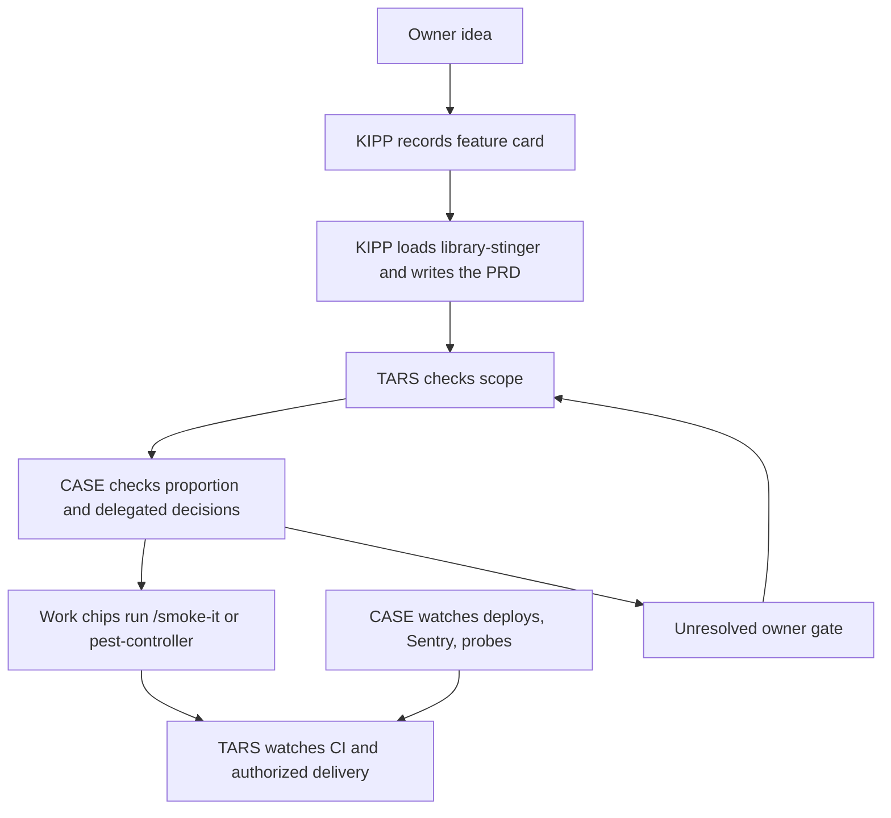

# TARS: manager, CASE and KIPP

Run `/tars <outcome>` in Claude Code Desktop's Code tab. TARS manages small work sessions, decisions, CI and handoffs. Every chip TARS spawns runs through `/smoke-it` or `/wasp-nest-core:source-command-pest-controller`. CASE is its adviser and scoped tie-breaker, and the read-only watcher of systems and CI. KIPP is the idea factory: it takes the owner's ideas, plans them and writes the PRDs after loading `/wasp-nest-core:library-stinger`. None of the three implements product code.

## Start with the right team

Fill or restore the [owner profile](references/templates/owner-profile.md) from current instructions. Spawn CASE first, KIPP next, then work chips. Confirm live tools and actual session state. Register the TARS session with `scripts/tars-registry.mjs`: where the `tars-compaction.mjs` hook is bound (the Wasp Nest Core plugin or an `install.sh` home install), it re-briefs TARS after every context compaction, so the operating rules survive ([lessons from 2026-11-02](guides/08-lessons-2026-11-02.md)). This workflow is only compatible with Claude Code Desktop, not terminal Claude Code, Cowork, ChatGPT/Codex or Cursor. CASE/KIPP are helper-session briefs inside TARS, not separate marketplace agents.

## What each part does

| Part | What it does | How to use it |
|---|---|---|
| TARS | Orchestrator: spawns chips, owns ledger, routing, questions, authorized merges and handoffs | Enter `/tars`, load the skill and profile, follow the start guide |
| CASE | Adviser: challenges overkill, one verdict per question with inline conditions; reports systems and CI changes to TARS, read-only | Spawn (an offer the owner starts) from [case-brief.md](references/templates/case-brief.md), send the ask, evidence and TARS lean |
| KIPP | Idea factory: captures ideas and owner answers, plans, writes PRDs with `library-stinger` loaded, maintains cards and index | Spawn (an offer the owner starts) from [kipp-brief.md](references/templates/kipp-brief.md), use the card/index templates |
| Ten-minute tick | Reads actual work output and acts on stalls | Arm `CronCreate` only when the task authorizes recurring management; idle between events |
| One-minute CI watch | Emits PR/check state changes; tick cross-checks it | Run the existing poller under `Monitor` with approved repository/check settings |

TARS plus CASE agreement grants no default permission. Co-approval and tie-breaking require a recorded owner delegation for the named task. Verify owner decision relays against their original source. Money, credentials, production, new dependencies and other gates still need the owner's specific yes.

KIPP prepares local cards and PRDs unless a docs PR is authorized, and drafts in its own session instead of a large subagent fleet. A no-CI docs lane needs the owner's policy and required path, contract and link proofs. Accepted contracts stay immutable by default. CASE and KIPP are never automatically archived.

## Reading order

1. [Operating model](guides/00-operating-model.md) and [CASE/KIPP roles](guides/07-case-and-kipp.md).
2. [Start and restore](guides/01-start.md), then [spawn and track](guides/02-spawn-and-track-chips.md).
3. [Tick](guides/03-ten-minute-tick.md), [CI watch](guides/04-ci-watch.md) and [decisions](guides/05-questions-and-decisions.md).
4. [Close-out](guides/06-close-out.md) and [manager handoff](references/templates/manager-handoff.md).
5. [Lessons from 2026-11-02](guides/08-lessons-2026-11-02.md): compaction survival and nine owner rules. Reread it after any compaction.

[REFERENCE.md](references/REFERENCE.md) maps the dated tool names, authority and state. [SKILL.md](SKILL.md) is the agent entry; [TOPIC.md](TOPIC.md) records scope. Research preserves mechanism evidence. The [CI poller](scripts/ci-poll.sh) runs the 1-minute CI watch. The [session registry](scripts/tars-registry.mjs) records the TARS session for the compaction hook.
