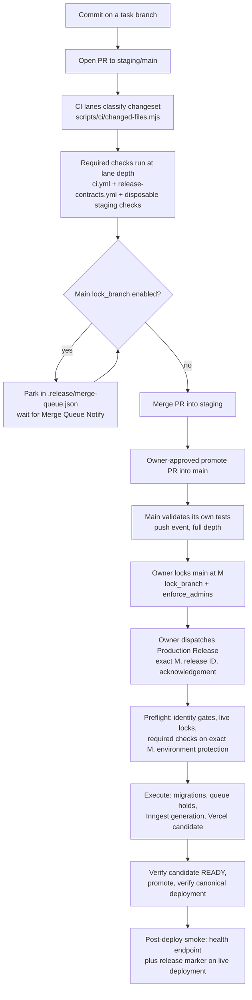

# End-to-End Delivery Pipeline: Commit to Verified Vercel Deploy

> Category: Infrastructure | Version: 1.0 | Date: September 2026 | Status: Active

Anyone shipping a change, operating a release, or debugging a stuck merge or deploy reads this to understand every stage a commit passes through from push to a verified production Vercel deployment, including the merge-freeze mechanics and the audit triage policy.

**Related:**
- [production-release.md](production-release.md)
- [ci-cd.md](ci-cd.md)
- [deployment-topology.md](deployment-topology.md)
- [worker-fleet.md](worker-fleet.md)
- [ADR-011](../architecture/ADR-011-vercel-marketplace-inngest-and-redis.md)
- [ADR-012](../architecture/ADR-012-inngest-replaces-fly-workers-fly-deprecated.md)
- [Required-check posture](../../../../docs/ci-required-checks.md)

---

## Why this map exists

Each stage of delivery was previously documented in isolation: PRD-038 documented the CI lanes up to the merge boundary, `production-release.md` documents the owner-dispatched release itself, and the connective tissue between them (staging merge, promote, freeze handling, what a deploy failure means) lived only in AGENTS.md rules and operator memory. The result was that "shipped" was inferred from a workflow succeeding rather than from a live check, and merge freezes produced either stalls or unsafe retry loops. This doc is the single map from commit to verified deploy. It documents current mechanics; it does not change approval semantics, which remain owner-controlled at every production boundary.

## The full pipeline at a glance

## Stage 1: PR lanes (commit to green checks)

Every PR is classified by `scripts/ci/changed-files.mjs` before any deep job runs. The classifier diffs the PR against its base SHA and sorts the changeset into a lane: process-only (docs, workflows, library Markdown, scripts, reviewed release evidence) takes scoped checks only; queue-health-only and inngest-only take focused lanes keyed to reviewed-byte pins; everything else, including any `package.json` or `package-lock.json` change (`isDependencyBump`), takes the full gate: TypeScript, Lint, six-shard Vitest, Build, Release and Worktree Contracts, Dependency Audit, and Sandbox MVP Regression. Unknown paths fail closed into the full gate. `deploy-preview-staging.yml` (now the Disposable Staging Checks workflow) additionally runs a disposable Postgres-plus-Redis schema and worker smoke on job-surface changes, and carries a per-PR concurrency group with same-PR supersession.

Which checks are required on which branch class, and why each runs at meaningful depth, is the CI half of the posture and lives in `docs/ci-required-checks.md`. The release half is Stage 5 below.

### Zombie third-party check suites

Three third-party GitHub Apps have left or can leave check suites on PRs that no required check depends on. The fly-io app was uninstalled from the repository by owner action on 2026-09-29; its suites stop appearing on new PRs, and residual in-repo Fly references (flyctl setup steps and the fleet-diagnose step in `production-release.yml`, the `fly.toml` trigger in `worker-image-build.yml`, the flyctl adapter in `scripts/release/provider-adapters.mjs`) are being removed under PRD-039. The vercel and coderabbitai apps remain installed and can leave check suites stuck QUEUED for a long time when a commit is rewritten (force-pushed or rebased): the app starts a suite on the old SHA, the SHA disappears, and the suite never reports. These suites are not required checks and never block mergeability on their own; if one appears to block, the actual blocker is elsewhere (a required check that has not reported, or a duplicate-name check run, see the blast-radius rule below). Do not wait out a long-QUEUED vercel or coderabbitai suite.

## Stage 2: merge into staging and the release-wait protocol

When a merge into main is refused because `lock_branch.enabled=true`, the release-wait protocol in AGENTS.md applies. It has three moving parts.

`lock_branch` is an owner-only toggle on the main branch-protection endpoint. It is the live freeze signal: the release coordinator requires live GitHub branch-protection responses showing `lock_branch.enabled=true` plus `enforce_admins.enabled=true`. A ruleset alone is not accepted as substitute evidence, and required checks alone are not a freeze. The local `.release/release-freeze.json` is advisory status only and may be stale; it is never freeze evidence.

`.release/merge-queue.json` is the parking lot. A session whose merge is refused appends exactly one entry of its own (`{pr, branch, readyCommit, resumeAction, parkedAt, parkedBy, status: "waiting"}`), records the block reason and resume action in its task ledger or PR body, and continues with any work that does not depend on the merge. A session edits only its own entry and never retries the merge, force-pushes, or attempts an admin merge against a lock.

`merge-queue-notify.yml` (the Merge Queue Notify workflow) polls the main protection endpoint every 10 minutes on an off-peak cron. When the lock lifts it comments on every parked PR with its queue position and resume action. It notifies; it never merges. The owning session executes its own resume action and removes its own queue entry after merging. This keeps merge consent with the session that owns the work.

Merges into staging are not freeze-gated the same way; the freeze protects main, the release boundary.

## Stage 3: promote into main

Promotion from staging to main is an owner-authorized step (the production shipping approval recorded in AGENTS.md covers it as the operator-action merge). The promote PR merges the reviewed staging head into main. For a normal release the owner then locks main at the resulting commit M, so the release dispatch targets one exact, immutable SHA. Required checks must be green first; an authorization to ship is never an authorization to skip gates.

## Stage 4: main validates itself

Every push to main re-runs the full-depth checks: push events never take a scoped lane, the full Vitest suite runs sharded, and Release and Worktree Contracts always run at full depth (the contracts workflow runs its gate classifier only on pull_request events and forces a full run on push). This is the PR #872 lesson: a required check that silently skips on the branch it protects is a rubber stamp, so main validates its own tests.

## Stage 5: production release dispatch

The Production Release workflow (`production-release.yml`) is owner-dispatched only, with a concurrency group `production-release` and cancellation disabled. Its inputs bind the release to an exact 40-character main SHA, a fresh release ID, the release kind (normal or hotfix), the operation (release, recover-candidate, recover-previous, recover-successor; the legacy diagnose-fleet option was removed with the Fly decommission in PRD-039), and an exact acknowledgement string printed by `release:plan`. An absent approval mode disables execution; env values are data, never shell source.

The preflight job runs `inngest-release-runtime.mjs --preflight` (normal) or `release-runtime.mjs --preflight` (recovery) and enforces the release half of the required-check posture: the input SHA, dispatch SHA, and workflow SHA must all equal M; the dispatch ref must be main; required GitHub Actions checks must have succeeded on M itself, not on a merge ref or staging head; `.release/release-policy.json` supplies the required check names on top of main's required checks (Quality Gates, Dependency Audit, Sandbox MVP Regression, Release and Worktree Contracts); and the runtime reads both branch-protection endpoints live for `lock_branch.enabled=true` and `enforce_admins.enabled=true`. The `Production` environment must permit only the `main` branch. Actor identity must match the owner (numeric actor ID equality on personal repositories, an owner-managed allowlist on organizations), and reruns fail closed rather than inheriting a previous dispatch's approval.

The execute job, in order: applies the reviewed production migrations (`apply-production-migrations.mjs`, one transaction per file, after durable release ownership is claimed and queues are held), then runs `inngest-release-runtime.mjs --execute`, which creates the Vercel candidate deployment, registers its protected Inngest callback, verifies candidate, runtime, and schema evidence, rechecks release controls, promotes exactly the recorded candidate, verifies canonical identity, and atomically admits the new Inngest backend generation before resuming queues. Recovery receipts are uploaded as artifacts regardless of outcome. The full mechanism, including queue holds and recovery semantics, is documented in [production-release.md](production-release.md).

## Stage 6: verified deploy

Shipped means verified-shipped. Verification is layered: the release runtime polls the Vercel deployment to READY and verifies its identity (project, SHA, environment) before promotion, and verifies the canonical deployment again after promotion. PRD-039 adds the final leg, a post-deploy smoke check that hits the live health endpoint and confirms the release marker on the deployed URL, so a green workflow plus a live-verified marker, not workflow success alone, is the evidence that a release is live. Evidence convention: every stage cites real Actions run URLs, no estimates.

## Advisory-drift audit policy

The Dependency Audit check runs `npm audit --package-lock-only`. Its failures are classified in two categories before anything is merged or dismissed.

A regression is a failure where the lockfile bytes changed relative to the last green audit: the changeset itself introduced the vulnerable version. A regression is fixed in the same PR that caused it; it is never classified away.

Advisory drift is a failure where npm published a new advisory against unchanged lockfile bytes: the world changed, the repository did not. Verification method: byte-compare the PR's `package-lock.json` against the lockfile of the last green audit run (for a PR, the base branch's most recent green run). If the bytes are identical, the failure is drift.

Drift classification never skips triage. Every advisory in the failure is individually triaged for severity and exploitability against what the repository actually runs, even on unchanged bytes: a critical, exploitable-in-context advisory on unchanged bytes is still an urgent same-major bump, while a low-severity advisory in an unused code path can ride until the next routine bump. The nodemailer 9 to 10 major upgrade (issue #866) is the standing example of a known-advisory decision deliberately deferred rather than silently classified away.

Resolution path for drift (when triage says bump): a minimal same-major bump PR, the shape of PR #915: undici 8.9.0 to 8.11.2 plus a cheerio override 7.29.0 to 7.29.1, plus reviewed-bytes repins for every pin that hashes the changed lockfile bytes. The bump PR is a dependency bump, so it takes the full gate by classifier policy.

Worked example, the 2026-09-29 incident: PR #909's Dependency Audit failed at 21:18 UTC on a lockfile byte-identical to main's, whose audit had been green at 20:47 UTC. Classification: advisory drift, because the bytes provably did not change between the green run and the red one; a new advisory was published in the window. The follow-up bump (PR #915) resolved it on the documented path, and the per-advisory triage of the undici advisory confirmed it warranted the immediate same-major bump rather than deferral.

## Batch-by-blast-radius rule

Any change touching package files, workflows, or shared scripts must first inventory what contracts, pins, or hashes reference them, before the change is written. This is a documentation-enforced rule (PRD-039 recommends documentation-only for now); the preflight-check automation is future optional work.

The canonical example: `scripts/ci/changed-files.mjs` maintains reviewed-bytes pins (`inngestReviewedFiles`) that SHA-256-hash `package.json`, `package-lock.json`, `.github/workflows/production-release.yml`, and `.github/workflows/release-contracts.yml`, among roughly a hundred other files. Any dependency bump changes the lockfile bytes and silently breaks the pin: the hash no longer matches, the changeset falls out of its scoped lane classification, and the release-contract tests fail until the pin is repinned to the reviewed new bytes. The undici bump in PR #915 broke exactly this contract and was repaired by the reviewed-bytes repin (commit e24820ef on the REL-20260928-DEPS path). The same applies in reverse: editing `production-release.yml` changes bytes its own pin hashes, so a workflow edit and its repin travel together.

The second example: two check runs sharing one display name on the same branch create a skipped duplicate that blocks mergeability. A branch carried two checks both named "Quality Gates"; GitHub's mergeability computation saw one instance skipped and reported the required check as not passed even though the other instance was green. Unique check names are part of the blast radius of any workflow edit that adds or renames a job.

Practical inventory checklist before touching a shared surface: grep for the filename in `.release/*.json` policy and contract files; check `inngestReviewedFiles` in `scripts/ci/changed-files.mjs`; check `production-release-workflow.test.mjs` and the other release-contract tests for content assertions on the file; and check that any check name you introduce or change is unique among check runs on the same ref.
